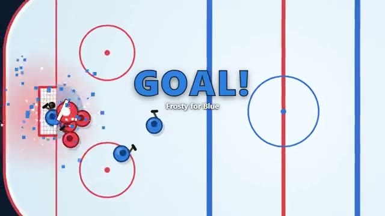

# Ice Rush

3-on-3 hockey: slap shots, body checks, goal horns. A multiplayer starter game from [Multiplayer Agent](https://multiplayeragent.com): 2D, versus, 2–6 players, with bots that fill empty seats.

## How it plays

Skate with real momentum, scoop up the puck and carry it on your stick. Hold to charge a slap shot, pass to a teammate, or body-check whoever has the puck. Each team has a goalie bot; most goals after three periods wins, and a tie goes to overtime.

**Controls:** WASD or arrows to skate, hold Space to shoot, X to pass, C to check, or a thumb stick with Shoot, Pass and Check buttons.

## Make it yours in the Game Builder

Open the [Game Builder](https://multiplayeragent.com), choose **Start from a starter game** and pick Ice Rush. It opens as version 1 in your studio, ready to play and publish. Then ask for changes, for example:

- Add a power play: a checked player sits out for 5 seconds
- Make the rink bigger with 4 on 4
- Add a fire puck power-up that shoots twice as fast

## Run it yourself

1. Get a free publishable key (`pk_…`) at [multiplayeragent.com](https://multiplayeragent.com).
2. In `index.html`, put it in place of `pk_REPLACE_ME` in the `MP_CONNECT` block.
3. Open `index.html` in a browser. No build step and no server needed.

Without a key it still runs, offline against bots.

## How it is built

- One `index.html`. The comment at the top of the script maps the code and explains the multiplayer.
- **Host-run physics:** One player's browser moves the puck, runs the goalies and keeps the score, so everyone sees the same play; if it leaves, the next player takes over. Picking up the puck, shots and checks are decided on the player's own screen, so a shot you see is a shot.
- **Leaderboard:** Most goals, for every player.
- **Bots:** Bots fill every empty skater spot and both nets, so it's always 3 on 3 plus goalies.
- **Live sync:** Every skater and the puck move for everyone at once.
- `?attract` runs it offline, bots only. The preview video is recorded from it.

## License

MIT.
